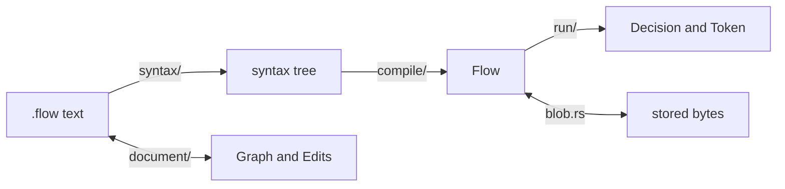
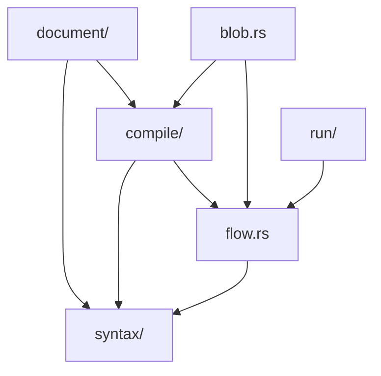

# Architecture

A map of the code and the rules that keep it in shape. For what a flow is and how it behaves,
read [DESIGN.md](DESIGN.md).

## How text becomes a decision

temple-dsl parses, checks and runs every expression and value, right where it sits in the file.
flow-runner owns the grammar around them: declarations, nodes, branches and outcomes.

`blob.rs` stores a compiled flow as bytes and loads it back. `document/` works beside the
pipeline for editors: the file's text stays the source of truth, `Graph` shows it, and each
`Edit` rewrites only the text it touches.

## Where things live

| Path | What's there |
| --- | --- |
| `src/lib.rs` | The public API and the crate docs |
| `src/flow.rs` | `Flow`, its node table, and what hosts can read from it |
| `src/blob.rs` | `Flow::to_bytes` and `Flow::from_bytes` |
| `src/common/` | Shared by every stage: diagnostics, error types and their wording, every limit, stored-format versions, the checksum |
| `src/syntax/` | Text to a tree: the tree and the language's keywords, the rule for names, a lexer for temple units, the parser |
| `src/compile/` | Tree to `Flow`: declarations, nodes, temple units, the names in scope, the checks across nodes, did-you-mean, the flow hash |
| `src/run/` | `Input`, `Decision` and `Trace`; one run in `walk.rs`; tokens and the values they carry in `token/` |
| `src/document/` | `Document`, each `Edit` as text changes, the check that an edit changed only what it said, the `Graph` |
| `src/bin/flow/` | The `flow` command, behind the `cli` feature |
| `tests/` | One file per area, with shared helpers in `common/` |
| `benches/` | Criterion benchmarks, and fixtures the throughput example shares |
| `examples/` | Example programs and flows |

Dependencies point one way:

Everything also uses `common/`, which uses nothing. Each stage adds its own methods to `Flow`:
`compile/` adds `compile` and `check`, `run/` adds `run` and `rebind`, and `blob.rs` adds
`to_bytes` and `from_bytes`. Nothing imports from `document/`.

A few layout habits: `src/` holds `lib.rs`, one entry per stage and `common/`; a stage is a single
file until it has parts, then a folder whose `mod.rs` holds its entry points; file names stay
short because the folder already says what they're about.

## Rules that must keep holding

The engine decides and the host acts. Nothing performs I/O, reads a clock or keeps state between
calls, and everything a run needs later travels in its `Token`.

No input can make the engine panic, loop forever or overflow the stack. Every limit lives in
`common/limits.rs`, `Limits` bounds each run, a flow can't jump in a loop without an event, and
graph walks keep their own stacks instead of recursing.

Checking a file takes time in proportion to its size. Each declaration is parsed only up to the
next one, each expression is checked against only the names it spells out, and flow-runner's
did-you-mean suggestions have a budget for the whole compile. `tests/diagnostics.rs` times
generated files to keep it that way. One gap remains: temple's own did-you-mean inside a single
check caps how many suggestions it looks for, not how much work they take (see
[BENCHMARKS.md](BENCHMARKS.md#hostile-input)).

Stored bytes are promises. `common/versions.rs` says which version to bump for which change, and
`tests/flows.rs` pins the example flows' hashes and a token byte for byte.

## Tests

`cargo test --all-features` runs the unit tests, everything in `tests/`, and the YAML tests next
to the example flows. The property tests are in `tests/properties.rs`. The timing tests only mean
something in an optimized build, so they're ignored unless you pass `--release`. The suite also
runs on `wasm32-wasip1`; [CONTRIBUTING.md](CONTRIBUTING.md) shows how.
