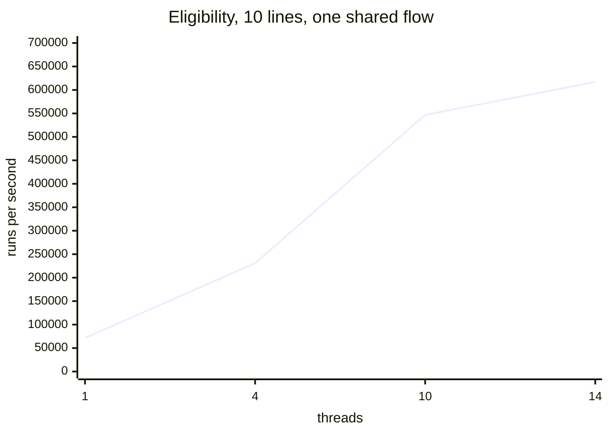

# Benchmarks

All numbers come from an Apple M4 Pro (10 performance and 4 efficiency cores, 24 GiB) running
macOS 27.0 on AC power, with rustc 1.97.0 and the release profile. To reproduce them:

```sh
cargo bench --bench flow_bench --features json                  # latency of each call
cargo run --release --features json --example throughput -- \
    <scenario> [seconds] [threads]                               # sustained load
```

The throughput scenarios are `eligibility-<lines>`, `lifecycle`, `ask`, `compile` and `load`.

## One call

Each figure is the median of a criterion benchmark.

### Running

| Call | Time |
| --- | --- |
| Start a return (`return-lifecycle`) | 1.13 µs |
| Resume with an event that jumps and parks | 2.17 µs |
| Resume with no event (ignored) | 1.33 µs |
| A whole return: start, approve, parcel, ask answered, settle | 11.2 µs |
| Start and stop at an ask (`carrier-quote`) | 1.43 µs |
| Answer the ask and get the quote | 3.21 µs |
| Fail the ask and retry with the second carrier | 2.91 µs |
| A quorum vote folded into node arguments (`spend-approval`) | 4.95 µs |
| An event in a 1,000-node flow | 2.21 µs |
| A jump, averaged over a chain of 900 | 76 ns |

### The engine next to hand-written Rust

This compares the eligibility flow with the same logic written by hand in Rust, over the same
`Value` input. Both are quadratic, since each order line scans the claimed lines.

| Order lines | Flow | Hand-written | Ratio |
| --- | --- | --- | --- |
| 1 | 3.47 µs | 0.78 µs | 4.5× |
| 10 | 14.2 µs | 6.04 µs | 2.4× |
| 100 | 259 µs | 105 µs | 2.5× |
| 1,000 | 15.9 ms | 4.84 ms | 3.3× |

With a single line, the run's fixed cost shows: it builds a token, which the hand-written
version doesn't.

### Compiling, saving and loading

| Flow | Source | Compile | Save | Load |
| --- | --- | --- | --- | --- |
| `return-eligibility` | 1.7 KB | 39.1 µs | 3.07 µs | 41.6 µs |
| `return-lifecycle` | 2.3 KB | 64.2 µs | 4.20 µs | 68.5 µs |
| `spend-approval` | 2.2 KB | 62.1 µs | | |
| `carrier-quote` | 1.1 KB | 26.7 µs | | |
| Generated, 10 nodes | | 96.8 µs | | |
| Generated, 100 nodes | | 998 µs | | |
| Generated, 1,000 nodes | | 10.1 ms | | 10.7 ms |

Compile time grows linearly, at about 10 µs per node. Loading a stored flow compiles its source
again, so it costs about the same as compiling. Checking a file that has errors takes 29 µs.

### Tokens

| Call | Time |
| --- | --- |
| `Token::inspect` | 1.37 µs |
| `Token::to_base64` | 80 ns |
| `Token::from_base64` | 309 ns |
| `Flow::rebind` | 2.12 µs |

For scale, converting host JSON to a `Value` takes 3.45 µs for a 10-line order and 272 µs for
1,000 lines.

## Sustained load

Each scenario runs on one thread for three seconds, and each run includes cloning its input, as
a host would. Allocations are counted in a separate pass, and peak memory is for the whole
process.

| Scenario | Runs/s | p50 | p99 | p99.9 | CPU per run | Allocations per run | Peak RSS |
| --- | --- | --- | --- | --- | --- | --- | --- |
| Eligibility, 1 line | 281,905 | 3.41 µs | 4.38 µs | 6.73 µs | 3.54 µs | 53 (9.6 KiB) | 3.5 MiB |
| Eligibility, 10 lines | 71,330 | 13.7 µs | 16.7 µs | 19.2 µs | 14.0 µs | 190 (39.3 KiB) | 3.7 MiB |
| Eligibility, 100 lines | 3,898 | 257 µs | 270 µs | 286 µs | 257 µs | 1,492 (333 KiB) | 4.0 MiB |
| Eligibility, 1,000 lines | 64 | 15.6 ms | 16.1 ms | 16.1 ms | 15.7 ms | 14,404 (3.1 MiB) | 7.7 MiB |
| A whole return, 5 calls | 88,164 | 11.1 µs | 13.8 µs | 16.6 µs | 11.3 µs | 138 (22.2 KiB) | 3.8 MiB |
| Start, then answer an ask | 198,276 | 4.94 µs | 6.15 µs | 7.15 µs | 5.04 µs | 49 (9.5 KiB) | 3.4 MiB |
| Compile `return-lifecycle` | 15,737 | 62.6 µs | 70.6 µs | 81.2 µs | 63.5 µs | 1,301 (132 KiB) | 4.7 MiB |
| Load its blob | 14,831 | 66.5 µs | 74.2 µs | 85.4 µs | 67.4 µs | 1,301 (132 KiB) | 4.8 MiB |

## Across cores

Every thread shares one compiled flow, with no locks, running the eligibility flow on a 10-line
order:



| Threads | Runs/s | Speed-up | CPU per run |
| --- | --- | --- | --- |
| 1 | 71,659 | 1.0× | 14.0 µs |
| 4 | 230,728 | 3.2× | 17.3 µs |
| 10 | 546,924 | 7.6× | 17.9 µs |
| 14 | 616,870 | 8.6× | 21.8 µs |

A whole return reaches 652,078 runs/s on 10 threads. CPU time per run goes up with the thread
count because the chip lowers its clock when every core is busy, and the last four cores are
the slower efficiency cores.

## Hostile input

Flows can come from users, so every way we've found to make the engine misbehave now has a
test:

| Input | What happens |
| --- | --- |
| An expression of 200,000 terms (781 KB) | Refused in 0.8 ms: it nests too deeply |
| 4,000 jumps to unknown nodes (231 KB) | 4,000 errors in 12 ms |
| 16,000 params and nodes (957 KB) | Checked in 35 ms |
| 40,000 params, and 40,000 lets that read an unknown name (1.9 MB) | 40,000 errors in 85 ms |
| `param input = 1` among 20,000 params and lets (836 KB) | One error, in 16 ms |
| 100 jumps to unknown 256-byte names among 14,000 alike ones (3.7 MB) | 100 errors in 11 ms; did-you-mean gives up once its work runs out |
| A 200,000-byte name inside an expression (400 KB) | Refused in 0.5 ms: a name is at most 256 bytes |
| A loop of 45,000 nodes whose first node jumps out of it 45,000 times (3.8 MB) | Reported in 82 ms |
| A chain of 50,000 jumps (1.1 MB) | Checked in 32 ms, and on a 2 MB stack in a debug build |
| 50,000 helpers calling each other in a chain | Refused in 47 ms: calls nest deeper than 64 |
| A flow on one line with 10,000 warnings | Each snippet is a window of the line: a 3 MB report in 3 ms |
| `items.map(i -> input.data)` over a 100 KB input | Refused at the step limit in 10 ms, with 62 MiB peak memory |
| `xs.all(x -> input.data.xs != null)` over 60,000 items | Refused at the step limit in 3 ms: reading a large value in place is charged |
| Host data nested 100,000 deep, through `unique` or `reverse` | Refused before it is copied or compared |
| A token carrying text over 4 KB | Resumes |
| A node argument that grows with every event | Refused past 1 MiB; the last token still resumes |
| A forged token with its counters at the maximum | Refused as a corrupt token |
| `input.event == null` guarding a loop of jumps | The loop is refused |
| An answered ask that ends in `ignore` after a jump | An error that hands back the waiting token |

One gap remains, and it's in temple-dsl. Its own did-you-mean, inside each check, limits how many
suggestions it looks for but not how much work they take. A 4 MiB file built for it, whose
expressions each spell hundreds of long, similar names next to misspellings of them, takes 89 s
to check. The fix belongs in temple: a suggestion budget that an embedder can share across
checks.

The limits behind these are in [DESIGN.md](DESIGN.md#limits).

## Sizes

A token takes 102 to 167 bytes, or 136 to 223 characters as base64, across the states the
example flows reach. A stored flow is its source plus 48 bytes.
