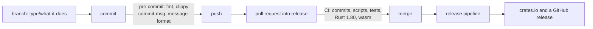
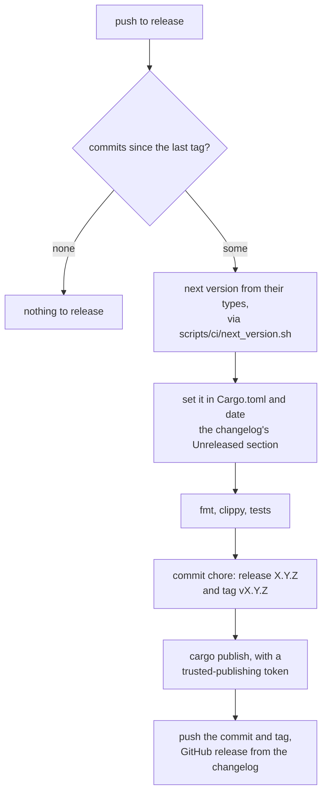

# Contributing

Thanks for taking the time. This page covers how to build and test flow-runner, what a commit
has to look like, and how releases happen. [ARCHITECTURE.md](ARCHITECTURE.md) is the map of the
code.

## Getting set up

The library and the `flow` command build on Rust 1.80 (`rust-version` in `Cargo.toml`). The
tests need a current stable Rust.

```bash
cargo test --all-features
```

The first `cargo test` also installs two git hooks from `.cargo-husky/hooks` into `.git/hooks`:
`pre-commit` runs `cargo fmt --check` and clippy, and `commit-msg` checks the message format
described below. They run the same checks CI does, so problems show up before you push. If you
build with `CARGO_TARGET_DIR` pointing outside the repository, the hooks aren't installed; run one
`cargo test` with the default target directory to get them.

## From branch to release



`release` is the main branch. Work happens on a branch named `type/what-it-does`, using the same
types as commit subjects (`fix/token-checksum`, `feat/flow-fmt`), and comes back through a pull
request.

## Commits

A commit message is a lowercase subject in the form `type: summary`, a blank line, and a body of
`- ` bullets:

```text
fix: keep a token's checksum ahead of its version

- token: check the checksum before reading the version, so a damaged
  version byte reads as damage instead of an unknown version
- tests: a token with a flipped version byte is refused as corrupt
```

- The type is one of `feat`, `fix`, `perf`, `refactor`, `docs`, `test`, `build`, `ci`, `chore`,
  `style` or `revert`. There's no scope in parentheses.
- Put `!` after the type (`feat!:`) for a change that breaks users.
- The subject is at most 72 characters.
- Each bullet names the area it touches, then says what changed and why, in at most 30 words.
  Longer bullets continue on indented lines. Keep it to 10 bullets.
- No trailers, and no `Co-authored-by` or generated-by lines.

`scripts/ci/lint_commit_msg.sh` enforces all of this. The `commit-msg` hook runs it on every
commit, and CI runs it on every commit in a pull request, along with a check of the branch name.

The commit types also decide the next version, so pick them with care: `feat!:` means a major
release, `feat:` a minor one, and anything else a patch.

Changes a user would notice get a line in [CHANGELOG.md](CHANGELOG.md), under `## [Unreleased]`,
in the same pull request.

## What CI checks

Pull requests run `scripts/ci/validate_pr.sh` on the branch name and commits, `shellcheck` and
`actionlint` on the scripts and workflows, and then the build itself:

```bash
cargo fmt --all -- --check
cargo clippy --all-targets --all-features -- -D warnings
cargo test --all-features
cargo test
cargo test --release --all-features --test diagnostics --test document
cargo run --all-features --example <name>     # each of the examples
RUSTDOCFLAGS="-D warnings" cargo doc --all-features --no-deps
```

The `--release` run is there for the timing tests, which are ignored in debug builds. Two more
jobs check that the library builds on Rust 1.80 and that the test suite passes on
`wasm32-wasip1`. To run the WebAssembly tests yourself:

```bash
rustup target add wasm32-wasip1
CARGO_TARGET_WASM32_WASIP1_RUNNER="wasmtime run --dir $PWD" \
    cargo test --target wasm32-wasip1 --features json
```

The tests read the example flows by their full path, so wasmtime needs access to the checkout.

## Code

- The layout is described in [ARCHITECTURE.md](ARCHITECTURE.md), along with the rules that must
  keep holding. Stored bytes matter most: `common/versions.rs` says which version a change has to
  bump.
- Public items need a doc comment (the crate has `#![warn(missing_docs)]`), and `unsafe` isn't
  allowed. Keep doc comments to a line unless there's a contract to explain. A `//` comment says
  why, not what.
- Each fact lives in one place: limits in `common/limits.rs`, versions in `common/versions.rs`,
  the rule for names in `syntax/names.rs`, keywords in `syntax/ast.rs`, and error wording shared
  between errors in `common/error.rs`.
- Errors for hosts are types in `common/error.rs`. Problems in a flow are `Diagnostic`s with a
  span, and every new check comes with a test in `tests/diagnostics.rs` that shows its message
  and line. Code in messages goes in backticks.
- Spell names out, and prefer named fields to tuples.
- A cache, fast path or `#[inline]` needs a benchmark or a caller that shows it's worth it.
- The example flows are documentation. When the language changes, the flows in `examples/flows/`
  and their `.flow.test.yaml` files change with it.

## Releases

Every push to `release`, which in practice means every merged pull request, runs the release
workflow in `.github/workflows/release.yml`:



crates.io only allows trusted publishing for a crate that already exists, so the first release
is done by hand, once:

1. Date the changelog with `scripts/ci/changelog.sh stamp 0.1.0 "$(date -u +%F)"`, commit, and
   tag the commit `v0.1.0`.
2. Run `cargo publish` from your machine, then push `release` together with the tag. The
   workflow sees no new commits since `v0.1.0` and does nothing.
3. On crates.io, add this repository as the crate's trusted publisher, with the workflow
   `release.yml` and the environment `publish`. GitHub creates the environment the first time
   the workflow uses it.

Until that first tag exists, the workflow skips every push. From then on, merging to `release`
is all it takes.
