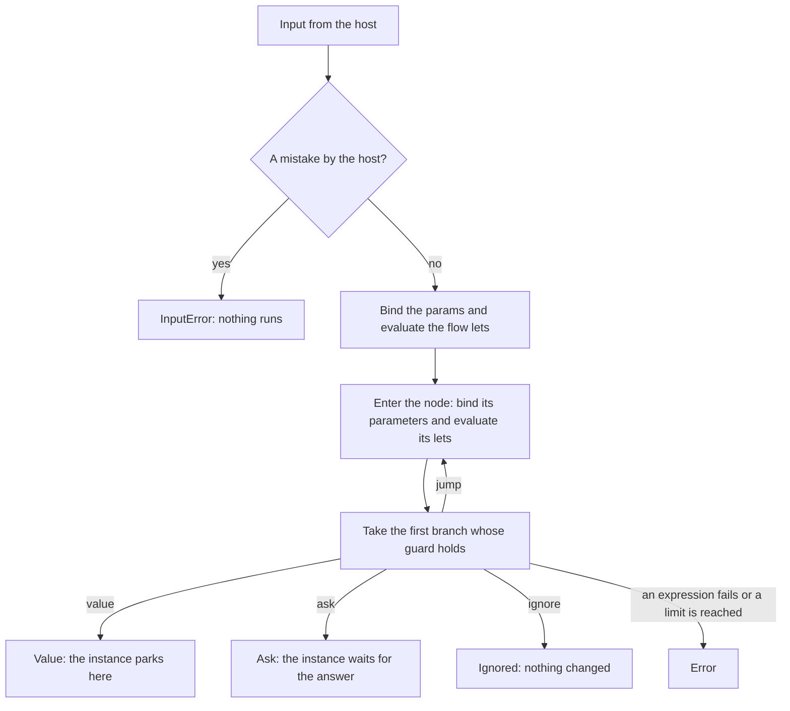
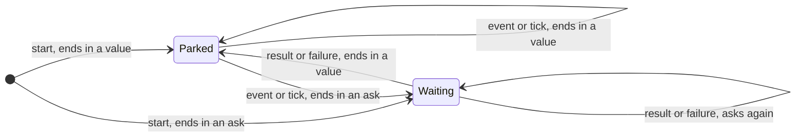
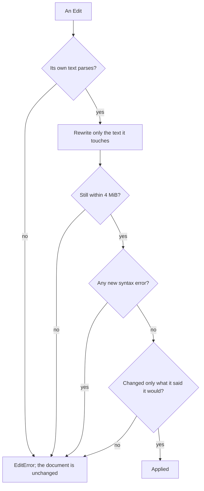

# Design

This document describes the `.flow` language, what happens during a run, and what the bytes
flow-runner hands out promise. The API itself is documented in rustdoc, and
[README.md](README.md) shows it in use.

flow-runner decides; it doesn't act. It doesn't do retries, timers or sagas, and it doesn't call
other systems, in parallel or otherwise. A flow returns data describing what should happen, and
the host does it and makes it safe to repeat.

## The language

```flow
edition 2026                        # the language version, always the first line

@<name> = <literal>                 # an annotation on the next flow, param or node
flow <name>
entry <node>, ...                   # nodes a new instance may start at; they take no parameters
events <name>, ...                  # events the flow takes; `tick` it always takes
param <name> = <literal>            # set by the host when an instance starts
let <name> = <expression>           # a value shared by the whole flow
let <name>(<a>, ...) = <expression> # a helper, which can't call itself

node <name>(<p>, ...) =
  let <name> = <expression>         # values local to the node
  when {
    <guard>: <outcome>              # checked in order; the first that holds is taken
    else:    <outcome>              # required
  }
```

A node with a single outcome can skip `when`: `node withdrawn = { "status": "WITHDRAWN" }`.

Guards, lets, arguments, ask payloads and `wake` times are temple expressions, with strings in
single quotes. Values are temple templates: JSON-like, with double quotes and `{{ }}` holes.

### Outcomes

| Outcome | What happens |
| --- | --- |
| `node(args)` | The run jumps to another node. Control doesn't come back. |
| a value | The run ends with this value and the instance parks at this node. `wake <time>` asks for a `tick` at that time. |
| `ask name(payload) -> node(args)` | The run ends by asking the host for something. The instance continues at `node` when the host resumes it with the answer. |
| `ignore` | Nothing happens, and the host keeps the token it has. |

### What a node can read

| Name | What it is |
| --- | --- |
| `input.data` | Data from the host, fresh on every run. |
| `input.event`, `input.payload` | The event and whatever came with it. Only the first node of a run sees them. |
| `input.arrived` | True when the run started the instance here or jumped here, false when the host resumed it here. |
| `input.result`, `input.failure` | The host's answer to an ask, or why it has none. Only in the node the ask continues at, and only on that run. |
| names | The node's parameters and lets, the params, the flow's lets and helpers. |

There's no clock. The host passes the time in `input.data`, in epoch seconds.

### Params, lets and helpers

A param is a constant for one instance. The host sets it when the instance starts, or the default
applies, and the token carries it from then on.

Flow lets are evaluated in order when a run starts, and again after its first jump, because that
jump uses up the event and any answer. A flow let sees whatever the node running it sees.

A helper sees params, its own parameters and other helpers. It doesn't see flow lets or its
caller's names, and it reads `input` as it is at the moment it's called.

### Annotations

`@name = literal`, or `@name` alone for true, sits on the flow, a param or a node. The engine
never reads annotations. It refuses duplicates and hands them to the host, which uses them for
things like `@label` and `@pos` in an editor. They don't change the flow's hash.

### Where declarations end

A declaration starts a line with its keyword, or with `@` for an annotation. Nothing inside a
declaration reaches past the next line that starts one: a string can't contain a line that begins
with `node`, and a value left open ends there, with an error at the end of its own text.

Inside a declaration, an expression ends where temple stops reading it, and temple keeps reading
across a line break when the next line starts with an operator. So in a node, a line that starts
with `-` after a `let` or a `wake` time continues it as a subtraction. Start that line with
something else, such as `(-input.data.change) > 0` for a guard or `{{ -1 }}` for a value.

### What the compiler checks

1. Every `when` ends with `else`. Use `ignore` to do nothing on purpose.
2. No two names in a flow are the same. A name starts with a letter and isn't a keyword or a
   temple builtin.
3. A loop of jumps needs an event: at least one jump in it must have a guard that holds only while
   an event is being delivered. That's `input.event == '<name>'`, written either way round, or an
   `&&` chain with that test as one link. The first jump uses up the event, so such a loop goes
   round at most once per run.
4. The node an ask continues at is entered only by that ask's answer. It can't be an entry or a
   jump target, and every branch in it jumps or asks again, because the answer is gone on the
   next run.
5. `input.event` is compared only with declared events or `tick`. A typo gets a did-you-mean, and
   comparing with a number or boolean, which can never match, is an error.
6. `input.result` and `input.failure` are read only in the node an ask continues at.
7. Param defaults and annotation values are literals (numbers, strings, booleans, `null`, and
   lists and objects of those), so tools can display and edit them.
8. The compiler also catches unknown nodes and names, with a did-you-mean; wrong argument counts;
   entries with parameters; duplicate declarations; unreachable nodes, as a warning; and every
   temple error, reported at its place in the `.flow` file.

### Limits

| Limit | Value |
| --- | --- |
| Source | 4 MiB |
| An expression or value | 512 KiB |
| A name, declared or inside an expression | 256 bytes |
| A value a token stores or a param takes | 128 levels deep |
| What a token carries: node arguments and params | 1 MiB |

Expressions are also held to temple's limits for embedded units, which refuse nesting far beyond
anything a person writes. On top of these, the host's `Limits` bound each run: evaluation steps
(which bound memory as well as time), jumps per run, and asks over an instance's life.

## A run



Host mistakes, such as an unknown entry or a token from another flow, come back as an
`InputError` before anything is evaluated. The first jump of a run evaluates the flow lets again,
as described above. Every other ending is a `Decision`:

- **Value.** The instance parks at the node with the arguments it arrived with. The decision
  carries the value, a wake time if the node asked for one, and the token to store.
- **Ask.** The token now waits for the answer, which only a resume with a `result` or a
  `failure` can give. A failure can't be `null`, since that reads as no failure.
- **Ignored.** Nothing happened, and the token the host already has stays good. A run that
  answered an ask, or that jumped, can't end this way, because the answer or the event behind the
  jump would be lost; those runs end in an error instead.
- **Error.** An expression failed or a limit was reached. Nothing was performed, since the engine
  never acts, and the decision hands back the token the run resumed. The host can fix the data or
  the flow and try again.

`wake` takes a whole number of epoch seconds, or `null` for no wake-up.

A traced run also returns each branch it took and how many steps it used. The trace holds node
names and branch positions, never values, because values may contain user data.

## Tokens

A token is where an instance is, as bytes. It holds the engine's semantics version, the flow's
name and the version of the flow that made it, the node the instance is at and the arguments it
came with, the params it started with, a sequence number, the number of asks so far, the wake
time it asked for, and the ask it's waiting on, if any. `Token::inspect` reads all of that except
the semantics version, the arguments and the params.

An instance is always in one of two states:



A few things follow from what a token is:

- It isn't signed. The checksum catches damage, not tampering, so keep tokens somewhere only the
  host can change them, like any other state it trusts.
- It's state, not identity. Two instances in the same state have equal tokens, so key instances
  by an id of your own.
- Its sequence number moves when the instance does: to another node or other arguments, to a
  different wake time, or into an ask. A run that leaves the instance where it was hands back the
  token it resumed, byte for byte, so the sequence number works as a compare-and-swap version.
- It runs only on the version of the flow that made it. Another version refuses it, and
  `Flow::rebind` moves it once the host has decided that's safe: its node must still exist and
  take the same number of arguments, and its params must still exist. Arguments travel by
  position, so a renamed or reordered parameter is the host's problem to catch.
- It outlives deployments. A newer flow-runner reads every token an older one made. A token made
  by a newer flow-runner is refused.

On the wire a token is `FTOK`, a version byte, the fields as a CBOR array, and the first eight
bytes of a SHA-256 of all that. As text it's URL-safe base64 without padding; padding and the
standard alphabet are accepted too.

## The flow hash

The hash is a flow's version. It covers what the flow does: its name, edition, entries, events,
params with their defaults, lets, helpers and nodes, plus the engine's semantics version. Each
expression and value is hashed as temple formats it, and that text parses back to the same tree,
so layout and comments drop out and nothing else does: `1`, `1.0` and `1.00` hash differently.
Annotations don't count, and neither does the order of entries, events, params, helpers and
nodes.

Temple keeps its formatting stable within a major version, and the hash depends on that. A
change in what flows mean bumps the semantics version, which changes every hash, and tokens then
need rebinding.

## Stored flows

`Flow::to_bytes` stores the source, not a compiled form:

```text
"FLOW" | version (4 bytes) | flow hash (32 bytes) | source | checksum (8 bytes)
```

Loading checks the checksum, then the version, compiles the source, and requires the stored
hash. A blob with a different layout is refused, and so is one whose source now compiles to a
different hash, since tokens made from it would no longer run. Either way, the source compiles
again on load.

## Editing

A visual editor opens a `.flow` file as a `Document`, draws its `Graph`, and applies `Edit`s:
adding, removing and renaming nodes, and changing branches, annotations, params, events and
entries. The text stays the source of truth.



A guard or outcome in an edit can't contain a `#` comment, because a comment would hide the rest
of the line it lands on. An edit that parses but leaves the flow wrong, such as removing a node
other nodes jump to, is still applied, and the problem shows up in the diagnostics.

## Who does what

temple-dsl evaluates expressions and templates. flow-runner parses, compiles and runs flows, with
no async, no I/O, no clock and no randomness. The host stores tokens, answers asks, schedules
ticks, and decides which asks each tenant may use.

## Not built yet

- `flow fmt`, which needs a syntax tree that keeps comments.
- Contracts: a schema for `data`, event payloads, ask answers and output, so `flow check` can
  catch paths that don't exist.
- A driver for the loop of run, answer an ask, run again. `examples/asks.rs` shows one written as
  host code.

## Open questions

- Can one flow reuse another flow's helpers, or must shared logic go through an ask?
- Should the engine ever read an annotation, such as `@private`? For now it doesn't.
