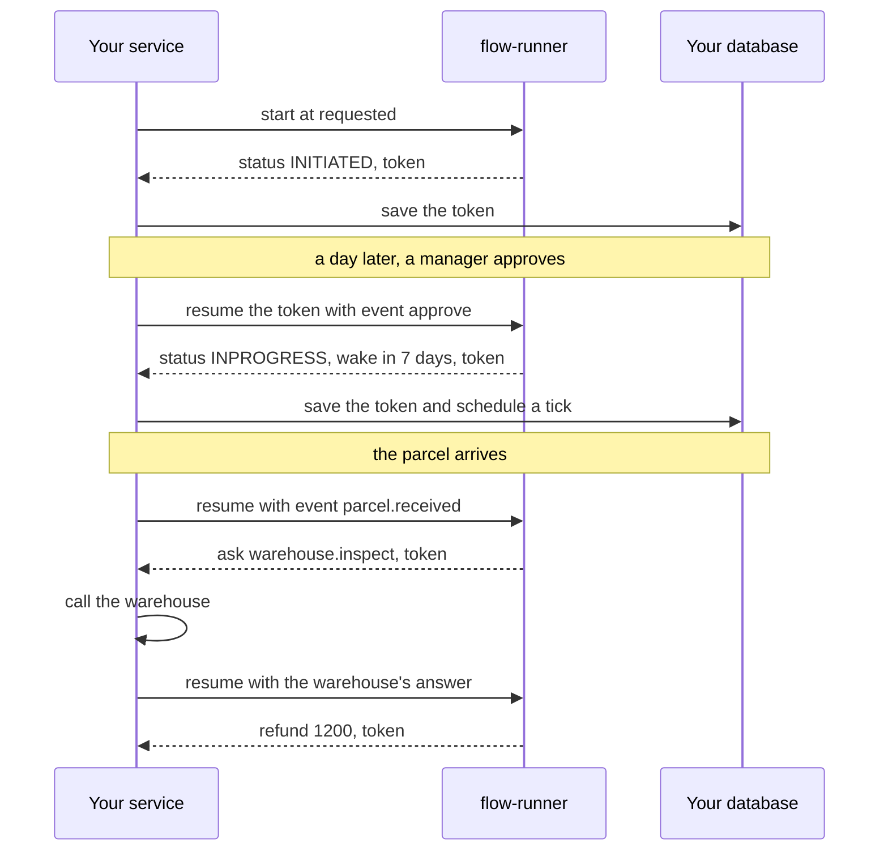

# Flow Runner

flow-runner runs business processes written as small graphs. You describe a process in a
`.flow` file (a return, an approval, a delivery quote) and your service asks it what should happen
next. The answer is plain data. flow-runner doesn't send the email or call the carrier; your code
does that. It never touches the network, the disk or the clock, which is what makes it safe to
run flows that your users write.

Expressions inside a flow are [temple-dsl](https://crates.io/crates/temple-dsl).

```flow
edition 2026
flow return-window
entry evaluate

param windowDays = 30

node evaluate =
  let age = input.data.evaluatedAt - input.data.deliveredAt
  when {
    age > windowDays * 86400: { "eligible": false, "reason": "WindowExpired" }
    else:                     { "eligible": true }
  }
```

Compile a flow once, when it's saved, then run it as often as you like. A compiled `Flow` is
immutable, so every thread can share one.

```rust
use flow_runner::{Decision, Flow, Input, Limits};

let flow = Flow::compile(&src)?;
let decision = flow.run(Input::start("evaluate", data), &Limits::default())?;
if let Decision::Value { value, .. } = decision {
    // {"eligible": true}
}
```

## Processes that wait

Most processes spend their time waiting for a manager, a parcel or a payment. A flow can wait
too, and flow-runner keeps nothing in memory while it does. Every run hands back a token; you save
it next to your own record, and when something happens you pass it back in with the event.



Here is the part of that flow that waits for the parcel:

```flow
node awaitingParcel(approvedAt) = when {
  input.event == 'parcel.received': inspecting(input.payload.lines)
  input.event == 'tick':            { "status": "INPROGRESS", "flag": "STALLED" }
  input.arrived:                    { "status": "INPROGRESS" } wake approvedAt + 7 * 86400
  else: ignore
}

node inspecting(lines) =
  ask warehouse.inspect({ "returnId": input.data.returnId, "lines": lines }) -> inspected()
```

A branch ends in one of four ways. It jumps to another node, returns a value (and can ask to be
woken later with `wake`), asks your service for something with `ask`, or does nothing with
`ignore`. How you answer an ask is your business: an HTTP call, a database lookup, another flow.

The whole flow is in [`examples/flows/return-lifecycle.flow`](examples/flows/return-lifecycle.flow),
and [`examples/lifecycle.rs`](examples/lifecycle.rs) drives it the way a service would.

## Why use it

Rules change more often than the code around them, and the people who own them often don't write
Rust. Keeping them in flows means they can change without a deploy, and a visual editor can open
a flow as a graph and edit it; `Document` applies each edit to the file's text and leaves the rest
of the file alone.

It's quick enough to call on every request: a decision usually takes a few microseconds (see
[BENCHMARKS.md](BENCHMARKS.md)). A flow can't loop forever or use more work than its step budget,
and mistakes are compile errors that point at the line. The same flow and input give the same
answer everywhere, WebAssembly included.

## The `flow` command

```sh
cargo install --path . --features cli      # from a checkout, until it's on crates.io

flow check return.flow                     # errors and warnings
flow run return.flow --data '{"evaluatedAt": 1774166400}'
flow run return.flow --token <token> --event approve
flow test examples/flows                   # every *.flow.test.yaml below the directory
flow graph return.flow                     # the graph as JSON, for editors
```

Tests sit next to the flow they test:

```yaml
# return-lifecycle.flow.test.yaml
tests:
  - name: approve, receive, inspect, refund
    answers:
      warehouse.inspect: { result: { passed: true, acceptedValue: 1200 } }
    steps:
      - entry: requested
        data: { evaluatedAt: 1774166400, returnId: R-1 }
        expect: { node: requested, value: { status: INITIATED } }
      - event: approve
        expect: { node: awaitingParcel, wakeAt: 1774771200 }
```

## Cargo features

`json` adds conversions between `Value` and `serde_json` and `Graph::to_json`. It's off by
default because it turns on serde_json's `arbitrary_precision` and `preserve_order` for your
whole build. `cli` builds the `flow` command.

## Further reading

[DESIGN.md](DESIGN.md) covers the language, the checks the compiler makes, and what tokens,
hashes and stored flows promise. [ARCHITECTURE.md](ARCHITECTURE.md) is a map of the code.
[examples/](examples/) has a program for each way to use the crate and four complete flows with
their tests. [CONTRIBUTING.md](CONTRIBUTING.md) explains how changes get in and how releases go
out; [CHANGELOG.md](CHANGELOG.md) lists what changed.

## License

MIT
