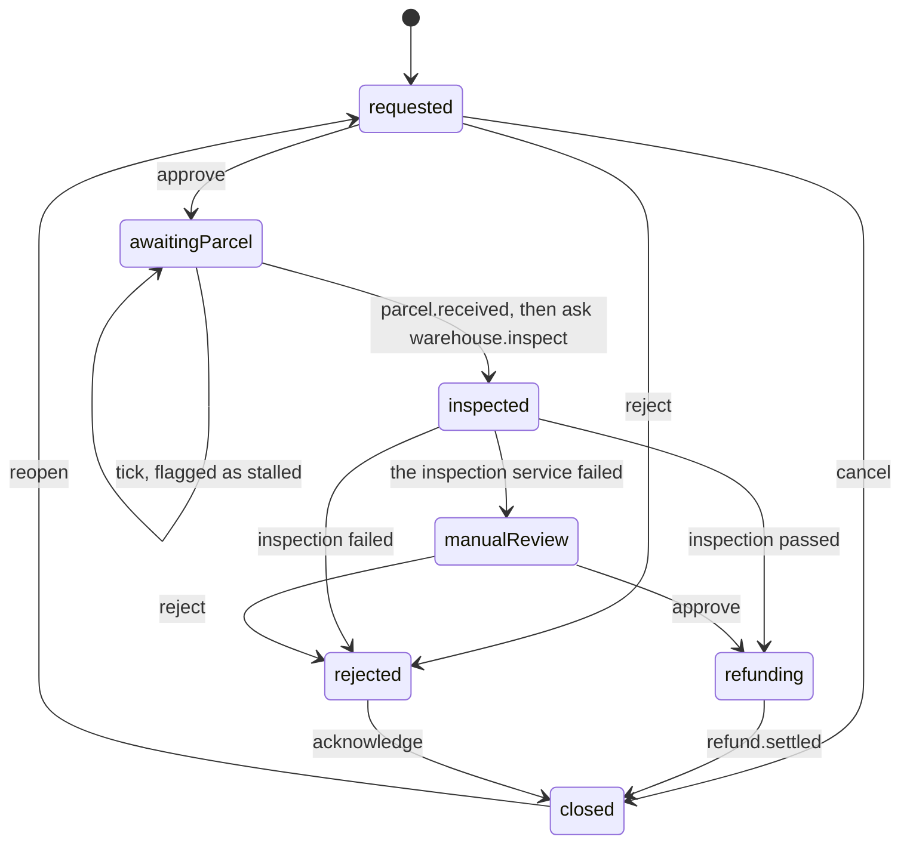
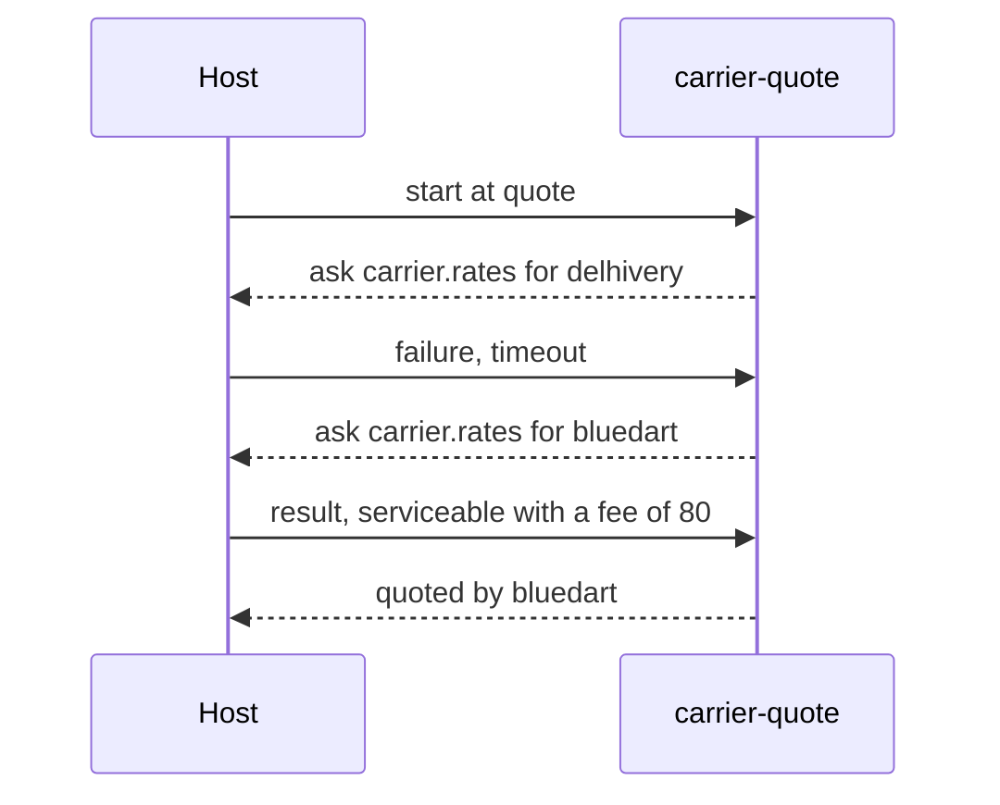

# Examples

## Programs

Each program shows one way to use the crate. `decide` and `versions` need no Cargo features; the
others need `json`.

| Program | What it shows |
| --- | --- |
| `decide.rs` | One decision per call: compile once, run per input, change a param for one instance, trace the branches a run took, and report a run that fails on bad data. |
| `lifecycle.rs` | A process that takes days: a token per instance, events as they happen, a scheduled `tick`, and an answered ask. |
| `asks.rs` | Answering asks with your own code, in a loop that runs until the flow decides, including a failure the flow works around. |
| `editor.rs` | The backend of a visual editor: a `Document`, its `Graph`, edits that keep the file's layout, and edits that get refused. |
| `versions.rs` | Shipping a new version of a flow: hashes, stored flows, and moving tokens across with `rebind`. |
| `throughput.rs` | Sustained load on many threads: runs per second, latency percentiles, CPU time, allocations and peak memory. |

```bash
cargo run --example decide
cargo run --features json --example lifecycle
cargo run --release --features json --example throughput -- lifecycle 3 4
```

## Flows

`flows/` holds four complete flows. Each `<name>.flow` has a `<name>.flow.test.yaml` next to it,
which `flow test` runs, and so does the crate's test suite.

`return-eligibility.flow` is a single decision: for each line of an order, can the customer send
it back? It uses params, a helper, a `when` over the input, and a jump with an argument.

`return-lifecycle.flow` follows a return from request to refund, over days. Events move it along,
`wake` flags a parcel that doesn't arrive in time, and an ask gets the warehouse's inspection:



`spend-approval.flow` routes a purchase through a risk check (an ask the host answers by running
another flow) and then through approvers. Node parameters carry the approvals collected so far
from one run to the next, and annotations give an editor labels to show.

`carrier-quote.flow` asks a carrier for rates and falls back to a second carrier when the first
one fails:



To try the flows from the command line:

```bash
cargo run --features cli -- check examples/flows/return-lifecycle.flow
cargo run --features cli -- test examples/flows
cargo run --features cli -- run examples/flows/return-eligibility.flow --data '{
  "evaluatedAt": 1774166400, "claimedLines": [],
  "order": { "deliveredAt": 1773734400, "discountCodes": [],
             "lines": [{ "lineId": "L1", "fulfilledQuantity": 2 }] } }'
```
